<!-- Retro header -->
<p align="center">
  
</p>

<!-- Language -->
<p align="center">
  <a href="https://github.com/Jeremysa1"></a>
  <a href="https://github.com/Jeremysa1/Jeremysa1/blob/main/README.en.md"></a>
</p>

<!-- Pixel art Jeremy: animated retro scene -->
<p align="center">
  
</p>

<p align="center">
  
</p>

<p align="center">
  <a href="https://www.linkedin.com/in/jeremy-s%C3%A1nchez-2747402b8/"></a>
  <a href="mailto:yeremisanchezarias@gmail.com"></a>
  
  
</p>

<br/>

## About me

I'm **Jeremy**, a software engineer from Medellín, Colombia. I love the side of software you don't see but that holds everything together: **backend architecture, the data model and the infrastructure** a product runs on.

My way of working is simple: understand the problem well before writing code. I think about how a system will be maintained a year from now, not just whether it works today. That's why I care about database design, document what I build and package everything in containers so it runs the same in any environment.

Beyond the backend, I'm passionate about **data**: turning messy information into something a team can use to make decisions, with SQL, Python and Power BI. I also keep a close eye on **cybersecurity** and **machine learning**, because I believe a good engineer builds with an eye on how things break and how they can get smarter.

Outside of code, I'm a fast learner, a clear communicator and someone who enjoys solving problems as a team.

<br/>

## Right now

<p align="center">
  
</p>

<br/>

## How I build software

<p align="center">
  
</p>

<br/>

## What I build

<table>
  <tr>
    <td width="33%" valign="top">
      <h3>⚙️ Backend</h3>
      Services in <b>Python / Django</b> with authentication, business logic and integrations documented with <b>OpenAPI</b>.
    </td>
    <td width="33%" valign="top">
      <h3>📊 Data</h3>
      Modeling in <b>PostgreSQL / MySQL</b>, SQL queries, automation with Python and dashboards in <b>Power BI</b>.
    </td>
    <td width="33%" valign="top">
      <h3>☁️ Delivery & cloud</h3>
      Containers with <b>Docker</b>, deployments on <b>Vercel</b> and <b>Railway</b>, and now <b>Azure</b> and cloud infrastructure.
    </td>
  </tr>
</table>

```yaml
engineer:
  name: Jeremy Sánchez
  role: Software Engineer
  focus: [backend, data, cloud]
  principles:
    - "Problem first, code second"
    - "If it's not documented, it's not done"
    - "Security is designed in from the start, not bolted on at the end"
  learning: [azure, cloud-infrastructure, iac, typescript, java]
```

<br/>

## Stack

<p align="center">
  <a href="https://www.python.org" title="Python"></a>
  <a href="https://www.djangoproject.com" title="Django"></a>
  <a href="https://www.postgresql.org" title="PostgreSQL"></a>
  <a href="https://www.mysql.com" title="MySQL"></a>
  <a href="https://www.docker.com" title="Docker"></a>
  <a href="https://aws.amazon.com" title="AWS"></a>
  <a href="https://git-scm.com" title="Git"></a>
  <a href="https://github.com" title="GitHub"></a>
  <a href="https://www.java.com" title="Java"></a>
  <a href="https://developer.mozilla.org/docs/Web/JavaScript" title="JavaScript"></a>
  <br/>
  <a href="https://react.dev" title="React"></a>
  <a href="https://developer.mozilla.org/docs/Web/HTML" title="HTML5"></a>
  <a href="https://developer.mozilla.org/docs/Web/CSS" title="CSS3"></a>
  <a href="https://dart.dev" title="Dart"></a>
  <a href="https://flutter.dev" title="Flutter"></a>
  <a href="https://vercel.com" title="Vercel"></a>
  <a href="https://www.postman.com" title="Postman"></a>
  <a href="https://www.figma.com" title="Figma"></a>
  <a href="https://www.kernel.org" title="Linux"></a>
  <a href="https://code.visualstudio.com" title="VS Code"></a>
</p>

<p align="center">
  
  
  
  
  
  
</p>

<br/>

## Featured projects

| | Project | What it solves | Stack |
|:-:|---|---|---|
| 🏨 | [**Hostal Santa Rosa**](https://github.com/Jeremysa1/Hostal_SanRosa) | Backend for a hostel's bookings, rooms, guests and tourist spots. JWT authentication, rate limiting and Swagger / ReDoc docs, ready for mobile and web apps. | `Django REST` `PostgreSQL` `JWT` |
| 🍔 | [**ChuzGrill**](https://github.com/Jeremysa1/ChuzGrill) | Landing page for a fast-food restaurant: brand, menu and direct contact through WhatsApp. | `React` `Vite` `Tailwind` |
| 🌐 | **Full-stack web platforms** | Apps with authentication, CRUD and business rules, deployed on Vercel. | `Django` `React` `PostgreSQL` |
| 📱 | **Mobile app** | Cross-platform app built with Dart. | `Dart` |
| 📈 | **Analysis pipelines** | Data extraction, cleaning and exploratory analysis. | `Python` `SQL` |

<br/>

## Activity

<!-- The player card is regenerated daily by .github/workflows/profile.yml with real stats -->
<p align="center">
  
</p>

<p align="center">
  
</p>

<p align="center">
  <picture>
    <source media="(prefers-color-scheme: dark)" srcset="https://raw.githubusercontent.com/Jeremysa1/Jeremysa1/output/github-snake-dark.svg" />
    
  </picture>
</p>

<br/>

<p align="center">
  <i>“Make it work, make it right, make it fast.” — Kent Beck</i>
</p>

<p align="center">
  
</p>
