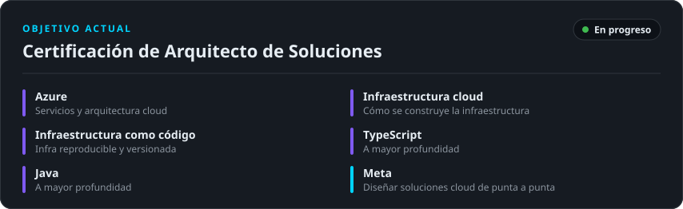
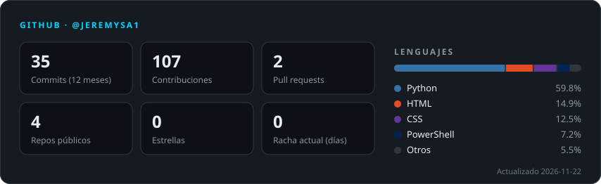

<!-- Cabecera -->
<p align="center">
  
</p>

<!-- Idioma -->
<p align="center">
  <a href="https://github.com/Jeremysa1"></a>
  <a href="https://github.com/Jeremysa1/Jeremysa1/blob/main/README.en.md"></a>
</p>

<!-- Espacio de trabajo: editor, terminal y del problema a la solución -->
<p align="center">
  
</p>

<p align="center">
  
</p>

<p align="center">
  <a href="https://www.linkedin.com/in/jeremy-s%C3%A1nchez-2747402b8/"></a>
  <a href="mailto:yeremisanchezarias@gmail.com"></a>
  
  
</p>

<br/>

## Sobre mí

Soy **Jeremy**, ingeniero de software en Medellín. Me gusta el lado del software que no se ve pero sostiene todo: **la arquitectura del backend, el modelo de datos y la infraestructura** sobre la que corre un producto.

Mi forma de trabajar es simple: entender bien el problema antes de escribir código. Pienso en cómo se va a mantener un sistema dentro de un año, no solo en que funcione hoy. Por eso cuido el diseño de las bases de datos, documento lo que construyo y empaqueto todo en contenedores para que funcione igual en cualquier entorno.

Además del backend, me apasionan **los datos**: convertir información desordenada en algo que un equipo pueda usar para decidir, con SQL, Python y Power BI. Y le sigo de cerca a la **ciberseguridad** y al **machine learning**, porque creo que un buen ingeniero construye pensando en cómo se rompen las cosas y en cómo se pueden hacer más inteligentes.

Fuera del código, soy alguien que aprende rápido, comunica claro y disfruta resolver problemas en equipo.

<br/>

## Ahora mismo

<p align="center">
  
</p>

<br/>

## Cómo construyo software

<p align="center">
  
</p>

<br/>

## Lo que construyo

<table>
  <tr>
    <td width="33%" valign="top">
      <h3>⚙️ Backend</h3>
      Servicios en <b>Python / Django</b> con autenticación, lógica de negocio e integraciones documentadas con <b>OpenAPI</b>.
    </td>
    <td width="33%" valign="top">
      <h3>📊 Datos</h3>
      Modelado en <b>PostgreSQL / MySQL</b>, consultas SQL, automatización con Python y visualización en <b>Power BI</b>.
    </td>
    <td width="33%" valign="top">
      <h3>☁️ Entrega y nube</h3>
      Contenedores con <b>Docker</b>, despliegues en <b>Vercel</b> y <b>Railway</b>, y ahora <b>Azure</b> e infraestructura cloud.
    </td>
  </tr>
</table>

```yaml
engineer:
  name: Jeremy Sánchez
  role: Software Engineer
  focus: [backend, data, cloud]
  principles:
    - "Primero el problema, después el código"
    - "Si no está documentado, no está terminado"
    - "La seguridad se diseña desde el principio, no se agrega al final"
  learning: [azure, cloud-infrastructure, iac, typescript, java]
```

<br/>

## Stack

<p align="center">
  <a href="https://www.python.org" title="Python"></a>
  <a href="https://www.djangoproject.com" title="Django"></a>
  <a href="https://www.postgresql.org" title="PostgreSQL"></a>
  <a href="https://www.mysql.com" title="MySQL"></a>
  <a href="https://www.docker.com" title="Docker"></a>
  <a href="https://aws.amazon.com" title="AWS"></a>
  <a href="https://git-scm.com" title="Git"></a>
  <a href="https://github.com" title="GitHub"></a>
  <a href="https://www.java.com" title="Java"></a>
  <a href="https://developer.mozilla.org/docs/Web/JavaScript" title="JavaScript"></a>
  <br/>
  <a href="https://react.dev" title="React"></a>
  <a href="https://developer.mozilla.org/docs/Web/HTML" title="HTML5"></a>
  <a href="https://developer.mozilla.org/docs/Web/CSS" title="CSS3"></a>
  <a href="https://dart.dev" title="Dart"></a>
  <a href="https://flutter.dev" title="Flutter"></a>
  <a href="https://vercel.com" title="Vercel"></a>
  <a href="https://www.postman.com" title="Postman"></a>
  <a href="https://www.figma.com" title="Figma"></a>
  <a href="https://www.kernel.org" title="Linux"></a>
  <a href="https://code.visualstudio.com" title="VS Code"></a>
</p>

<p align="center">
  
  
  
  
  
  
</p>

<br/>

## Proyectos destacados

| | Proyecto | Qué resuelve | Stack |
|:-:|---|---|---|
| 🏨 | [**Hostal Santa Rosa**](https://github.com/Jeremysa1/Hostal_SanRosa) | Backend para reservas, habitaciones, clientes y sitios turísticos de un hostal. Autenticación JWT, control de peticiones y documentación Swagger / ReDoc, listo para apps móviles y web. | `Django REST` `PostgreSQL` `JWT` |
| 🍔 | [**ChuzGrill**](https://github.com/Jeremysa1/ChuzGrill) | Landing para un restaurante de comidas rápidas: presentación, carta y contacto directo por WhatsApp. | `React` `Vite` `Tailwind` |
| 🌐 | **Plataformas web full stack** | Aplicaciones con autenticación, CRUD y reglas de negocio, desplegadas en Vercel. | `Django` `React` `PostgreSQL` |
| 📱 | **App móvil** | Aplicación multiplataforma con Dart. | `Dart` |
| 📈 | **Pipelines de análisis** | Extracción, limpieza y análisis exploratorio de datos. | `Python` `SQL` |

<br/>

## Actividad

<!-- La tarjeta de estadísticas la regenera .github/workflows/profile.yml cada día -->
<p align="center">
  
</p>

<br/>

<p align="center">
  <i>“Hazlo funcionar, hazlo correcto, hazlo rápido.” — Kent Beck</i>
</p>

<p align="center">
  
</p>
